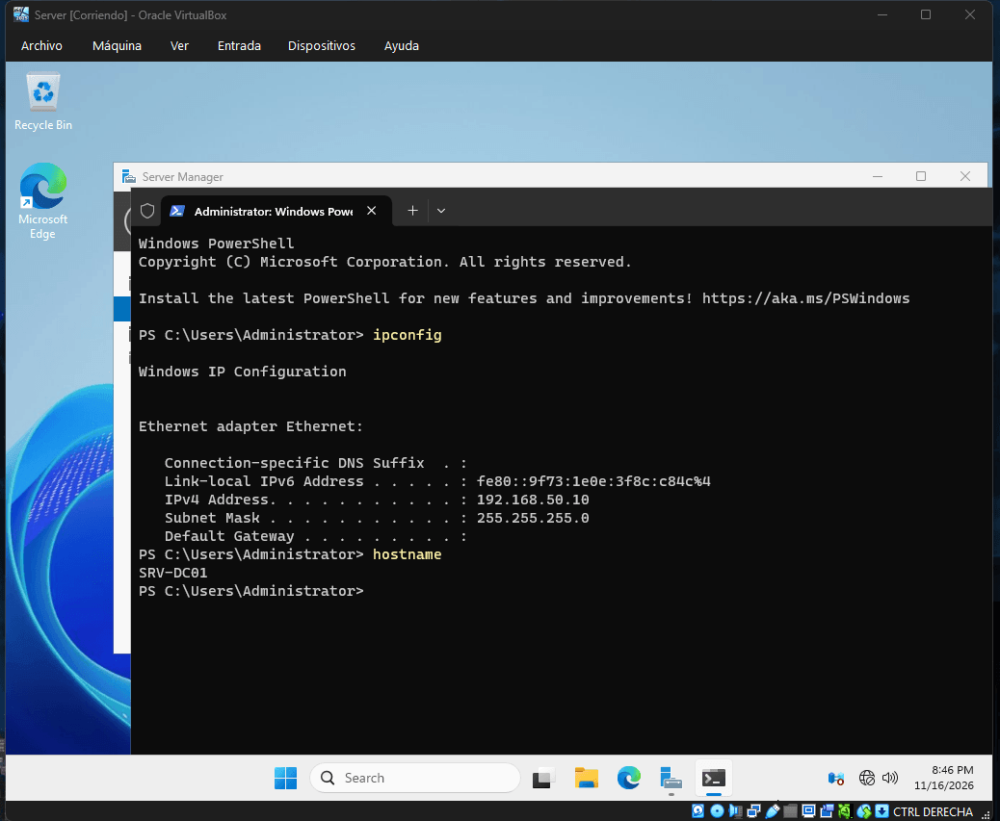
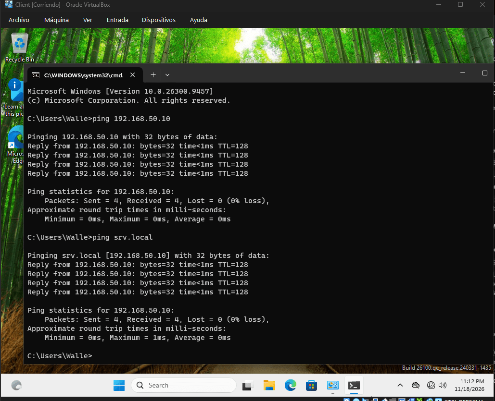
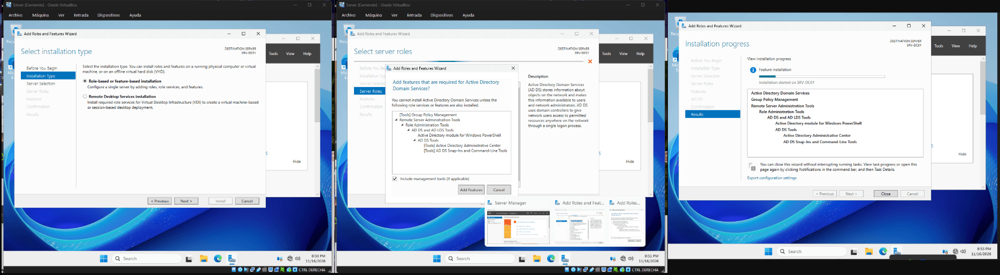
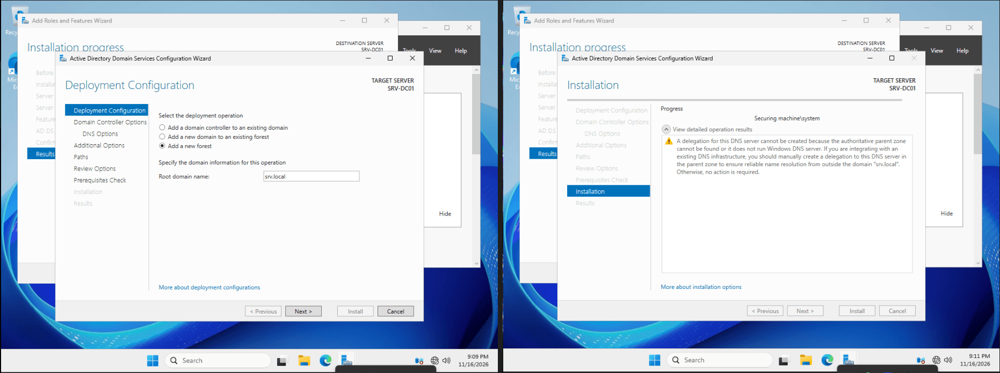

# 01 – Active Directory

## Arquitectura
Configuré dos máquinas virtuales en VirtualBox sobre una red interna, para simular un entorno aislado:

- **SRV-DC01:** Windows Server 2025, IP estática **192.168.50.10**, dominio **srv.local**.
- **Cliente:** Windows 11 Enterprise, IP **192.168.50.20**, con el DNS apuntando al servidor.

Capturas

## Estructura
Instalé los roles y características del Administrador del servidor para promover el servidor a controlador de dominio, separé a los usuarios en unidades organizativas para ordenarlos por función y facilitar la gestión de accesos.

Capturas

En la unidad **Support_TI** creé la cuenta **f.ramos**, miembro del grupo **Domain Admins** para mantener buenas practicas de seguridad y no administrar desde el **SRV\Administrator** .

